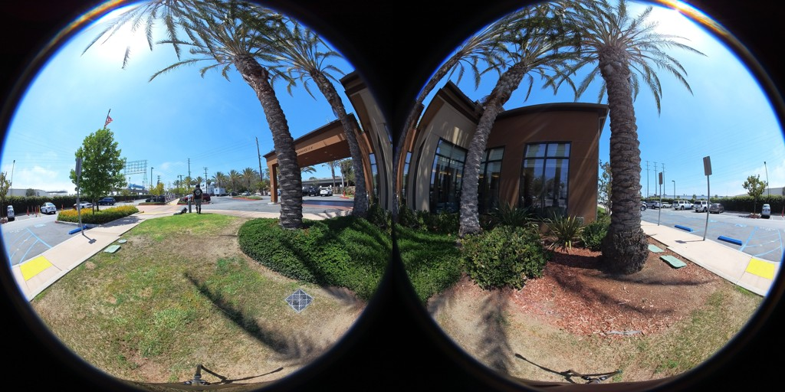

# PhotoSphere Linux

This is a simple app with a GUI for automatic stitching images or videos.
- Supports DNG (RAW image file format)
- Supports INSV (raw 360-degree video file format)
  - For INSV it can make from a dual fish-eye video a stitched 360 photo but doesn't render/stitch the all video only if you hit export

| Dual fisheye input | Qt GUI | Stitched panorama |
| :---: | :---: | :---: |
|  |  |  |
