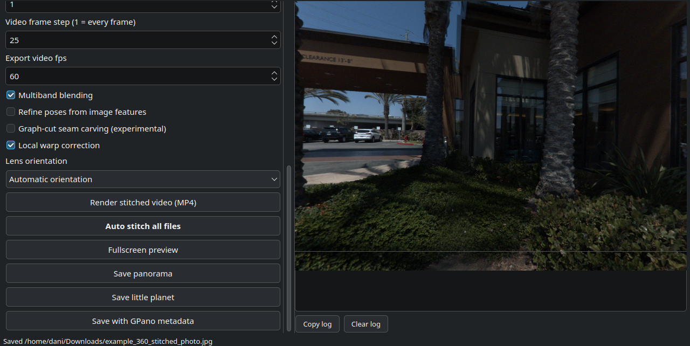

# PhotoSphere Linux

This is a simple app with a GUI for automatic stitching images or videos.
- Supports DNG (RAW image file format)
- Supports INSV (raw 360-degree video file format)
  - For INSV format, the software can extract a stitched 360-degree image from a dual-fisheye video; however, full video stitching and rendering occur only upon export

| Dual fisheye input | Qt GUI | Stitched panorama |
| :---: | :---: | :---: |
|  |  |  |
