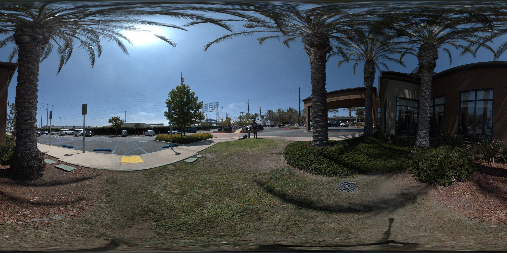

# Photosphere Linux

This is a simple app with a GUI for automatic stitching images or videos.
- Supports DNG (RAW image file format)
- Supports INSV (raw 360-degree video file format)
  - For INSV format, the software can extract a stitched 360-degree image from a dual-fisheye video; however, full video stitching and rendering occur only upon export

| Dual fisheye input | Qt GUI | Stitched panorama |
| :---: | :---: | :---: |
|  |  |  |
 
- This app works best with dual-fisheye footage.

## Install it from here
- Grab the latest Appimage from [GitHub Releases](https://github.com/theclumsypirate/photosphere-linux/releases/latest)

## Credits

| Project | License | How it is used |
| --- | --- | --- |
| [OpenCV](https://opencv.org) | Apache-2.0 | Stitching engine: spherical warping, feature matching, exposure and multiband blending. |
| [LibRaw](https://www.libraw.org) | LGPL-2.1 or CDDL-1.0 | DNG/RAW decoding, white balance and colour matrices. |
| [FFmpeg / libav](https://ffmpeg.org) | LGPL-2.1+ (GPL components in AppImage) | Demux and decode INSV, MP4, MOV and MKV; write H.264 output. |
| [x264](https://www.videolan.org/developers/x264.html) | GPL-2.0+ | H.264 encoder used for exported panorama videos. |
| [Qt 6](https://www.qt.io) | LGPL-3.0 | GUI, OpenGL 360 viewer and desktop integration. |
